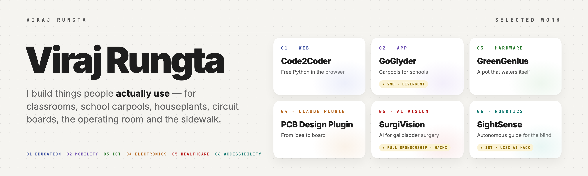
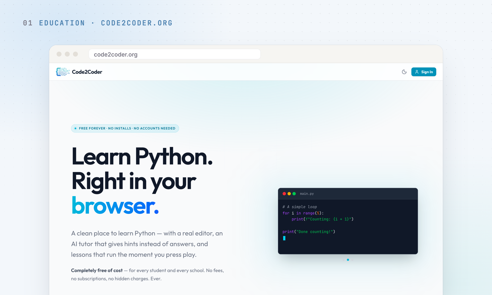
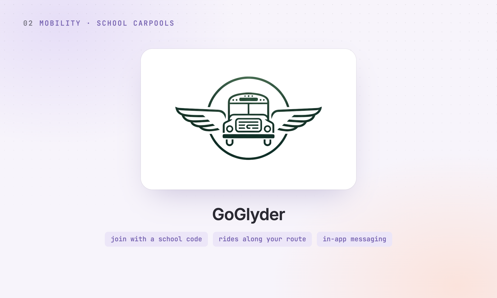
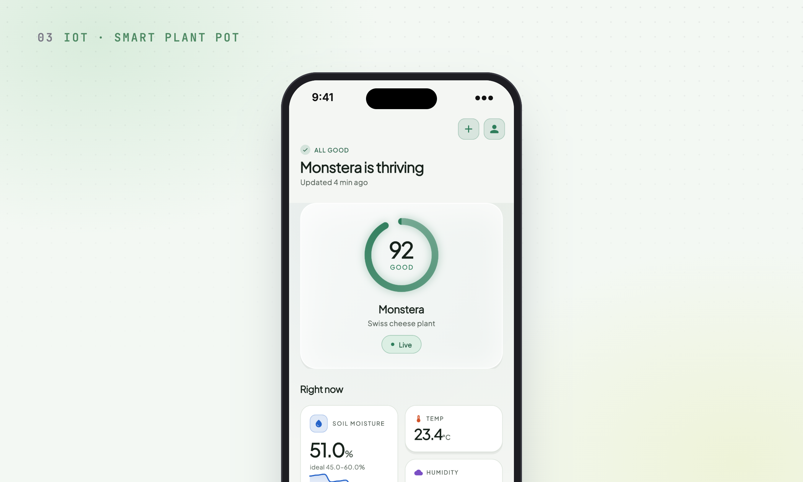
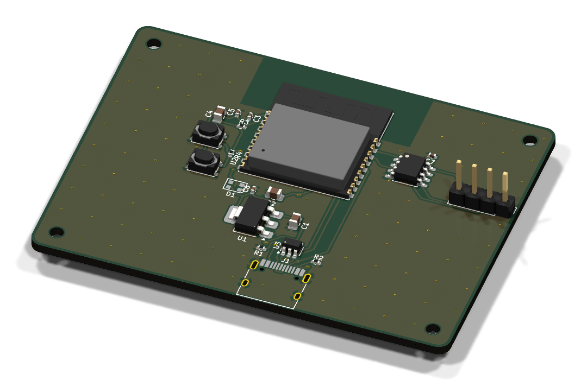
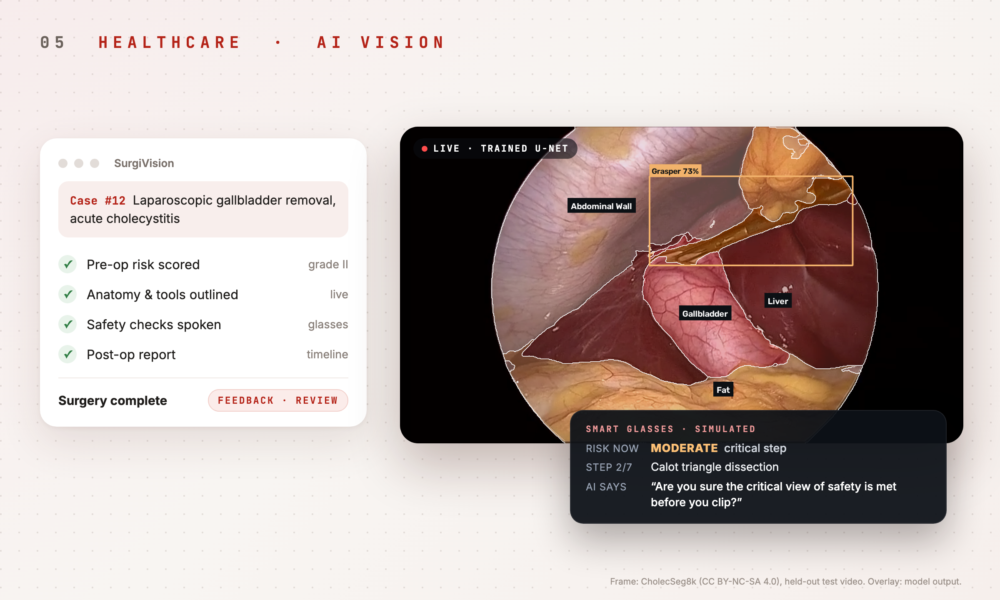
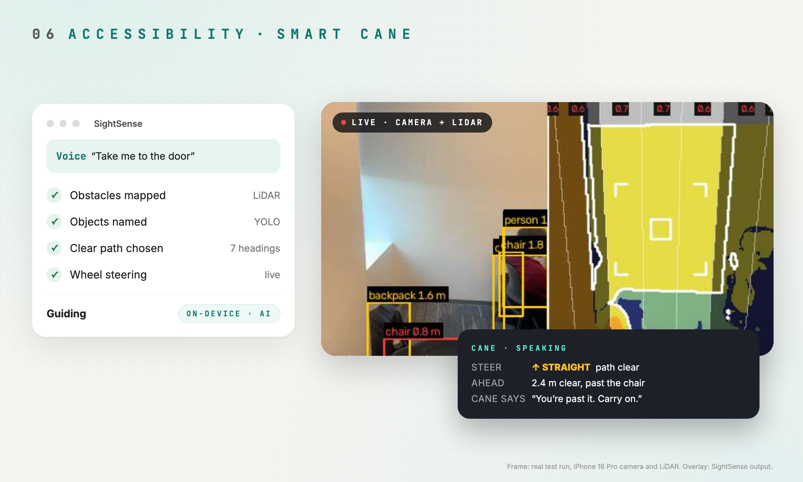

<table>
<tr>
<td width="50%" valign="middle">

</td>
<td width="50%" valign="middle">

<b><code>01</code> &nbsp;EDUCATION · WEB</b>

### [Code2Coder](https://code2coder.org)

**Free Python lessons that run in the browser.**

A real editor, lessons that run the moment you press play, and an AI tutor that hints at the fix instead of handing over the answer. Python runs on-device through WebAssembly: nothing to install, no account, free for every school.

  

**[Live ↗](https://code2coder.org)** &nbsp;·&nbsp; **[Source ↗](https://github.com/virajrungta/CodeToCoder)**

</td>
</tr>
<tr>
<td width="50%" valign="middle">

<b><code>02</code> &nbsp;MOBILITY · APP</b>

### [GoGlyder](https://github.com/virajrungta/go_glyder)

**Carpooling built around a school community.**

Schools onboard with a join code and publish their calendar. Families post or find rides along their route, see the detour before they commit, and message the driver in the app. Fewer cars at pickup, fewer hours lost to driving.

   

**[Source ↗](https://github.com/virajrungta/go_glyder)**

</td>
<td width="50%" valign="middle">

</td>
</tr>
<tr>
<td width="50%" valign="middle">

</td>
<td width="50%" valign="middle">

<b><code>03</code> &nbsp;IOT · HARDWARE</b>

### [GreenGenius](https://github.com/virajrungta/GreenGenius)

**A plant pot that reports back, and waters itself.**

It tracks how your plant is doing, tells your phone when something's off, and waters it on its own, so houseplants stop dying from guesswork.

  

**[Source ↗](https://github.com/virajrungta/GreenGenius)**

</td>
</tr>
<tr>
<td width="50%" valign="middle">

<b><code>04</code> &nbsp;ELECTRONICS · CLAUDE PLUGIN</b>

### [PCB Design Plugin](https://github.com/virajrungta/pcb-claude-plugin)

**From idea to board.**

A Claude Code plugin: describe the board you want in plain English. It asks a few questions, picks real parts, designs the schematic and layout, checks for mistakes and electrical noise, and hands you the files a factory needs. It gets better with every board. Free and open source.

  

**[Source ↗](https://github.com/virajrungta/pcb-claude-plugin)**

</td>
<td width="50%" valign="middle">

</td>
</tr>
<tr>
<td width="50%" valign="middle">

</td>
<td width="50%" valign="middle">

<b><code>05</code> &nbsp;HEALTHCARE · AI VISION</b>

### SurgiVision

**An AI assistant for gallbladder surgery.**

Before the operation it scores the case's risk. During it, a model I trained on real surgery video outlines the liver, gallbladder and instruments live, and simulated smart glasses speak safety checks like *"Is the critical view met before you clip?"* Afterwards it writes up what happened. A research prototype, not for clinical use.

   

Built with Anshuman Kumar

</td>
</tr>
<tr>
<td width="50%" valign="middle">

<b><code>06</code> &nbsp;ACCESSIBILITY · ROBOTICS</b>

### [SightSense](https://github.com/ConnorSawaya/SightSense)

**Autonomous walking guidance for people who are blind.**

A self-steering cane that sees the way ahead for you. Say *"take me to the door"* and a motorized wheel at its tip steers you there, around chairs, people and walls. An iPhone's camera and LiDAR feed a local AI that picks a clear path, names objects, reads signs and talks you through it. An experimental prototype.

   

**[Source ↗](https://github.com/ConnorSawaya/SightSense)** &nbsp;·&nbsp; Built with Connor Sawaya, Aryan Kulkarni and Anshuman Kumar

</td>
<td width="50%" valign="middle">

</td>
</tr>
</table>

  <a href="https://www.linkedin.com/in/viraj-r711/">LinkedIn</a> &nbsp;·&nbsp;
  <a href="mailto:virajrungta@gmail.com">virajrungta@gmail.com</a> &nbsp;·&nbsp;
  <a href="https://code2coder.org">code2coder.org</a>

